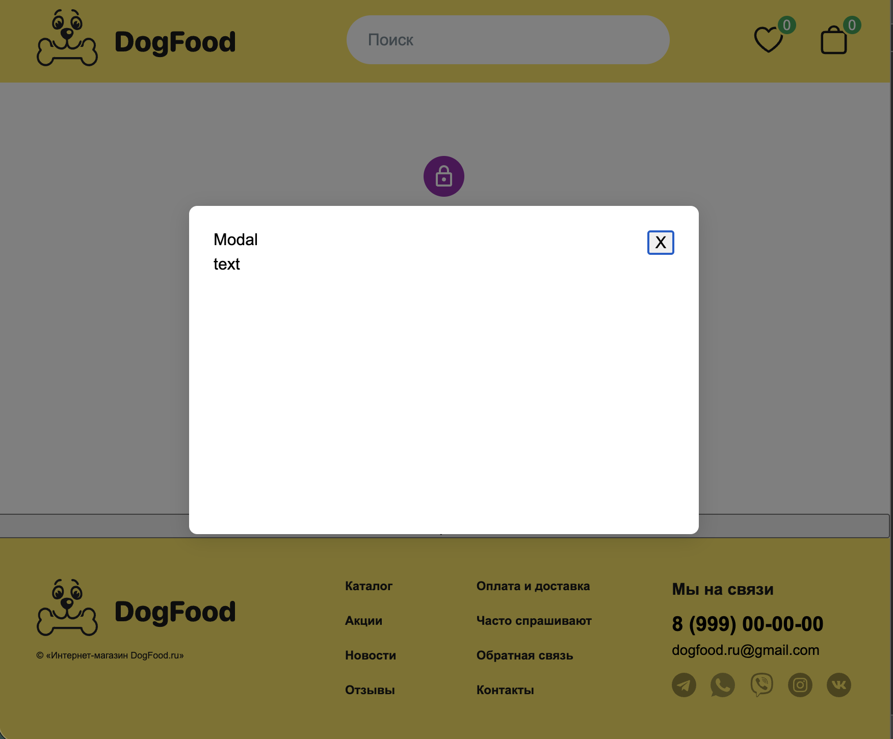
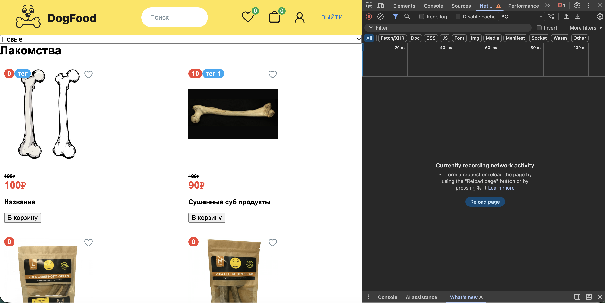
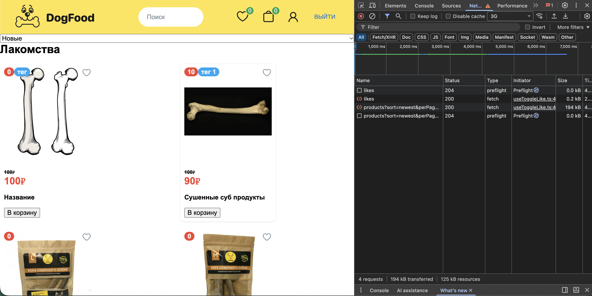
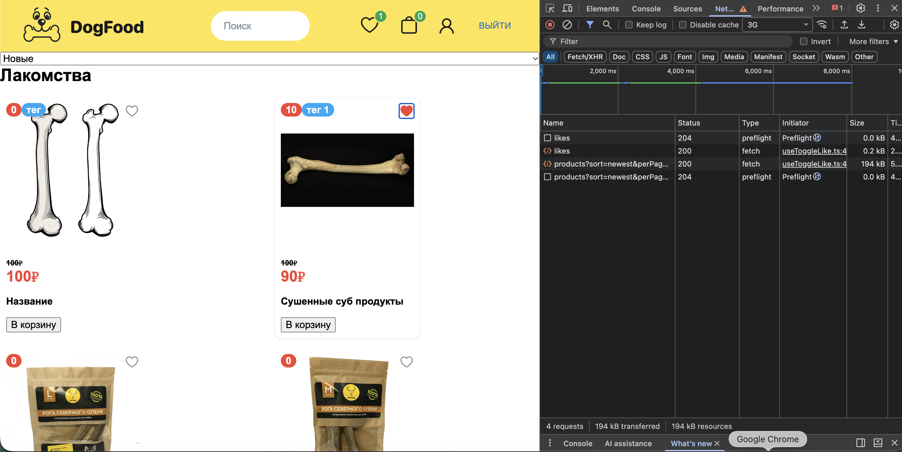
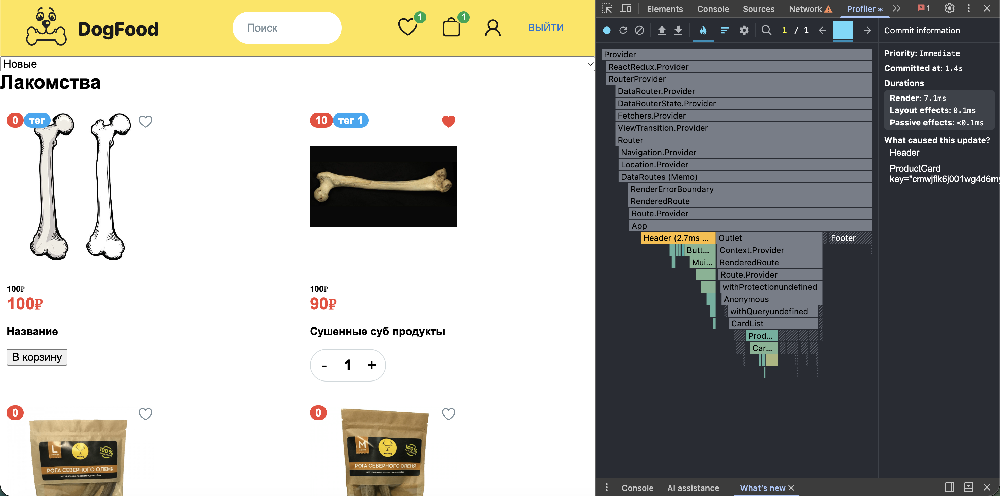

# React PRO — финальный проект

## О проекте

Проект интернет-магазина, доработанный в рамках курса React PRO. Цель работы — улучшить архитектуру существующего приложения, оптимизировать рендеринг компонентов, внедрить современные возможности React, реализовать модальное окно через React Portal и настроить альтернативную production-сборку с помощью esbuild.

## Используемые технологии

- React 19.3.1
- TypeScript
- Redux Toolkit
- RTK Query
- React Router v6
- React Hook Form
- Yup
- React Toastify
- Webpack 5
- esbuild
- CSS Modules

## Что было сделано

- Переработана структура проекта и разделена ответственность между UI-компонентами и бизнес-логикой.
- Функциональность авторизации, регистрации, поиска, корзины и работы с товарами организована по фичам.
- Переиспользуемые UI-компоненты вынесены в `shared/ui`.
- Оптимизирован рендеринг карточек товаров с помощью `React.memo` и уточнения Redux-селекторов.
- Проведён анализ рендеров с помощью React DevTools Profiler.
- Реализовано модальное окно через React Portal.
- Добавлено управление фокусом в модальном окне, закрытие по Escape и клику на overlay.
- Применён `useRef` для хранения DOM-ссылок и управления фокусом.
- Реализовано оптимистичное обновление избранного с помощью React 19 `useOptimistic`.
- Настроена альтернативная production-сборка через esbuild.
- Проведено сравнение Webpack и esbuild по времени сборки и размеру основных файлов.

## Архитектура проекта

Проект организован с разделением по назначению модулей.

```text
src/
├── app/                 # Настройки и стили приложения
├── shared/
│   ├── ui/              # Переиспользуемые UI-компоненты
│   └── store/           # Redux Store, API, селекторы и общие хуки
├── features/
│   ├── auth/            # Авторизация и регистрация
│   ├── cart/            # Работа с корзиной
│   ├── products/        # Функциональность товаров
│   └── search/          # Поиск
├── pages/               # Страницы приложения
├── widgets/             # Композиционные блоки интерфейса
└── ...
```

### Принципы разделения

- `shared/ui` содержит переиспользуемые UI-компоненты.
- `features` содержит пользовательские сценарии и связанную с ними бизнес-логику.
- `pages` отвечает за страницы приложения.
- `widgets` объединяет компоненты и функциональность для формирования крупных блоков интерфейса.
- `shared/store` содержит общую инфраструктуру работы с Redux, API и селекторами.

UI-компоненты получают необходимые данные и обработчики через props, а бизнес-логика размещается в соответствующих фичах.

## Оптимизация рендеринга

Для анализа использовался React DevTools Profiler.

### Найденная проблема

При изменении данных в каталоге повторно рендерились карточки товаров, даже если данные конкретных товаров не изменялись.

### Что было изменено

- Компонент `ProductCard` обёрнут в `React.memo`.
- Уточнён Redux-селектор: вместо избыточных данных компонент получает необходимое булево значение.
- Проверено поведение списка при сортировке и добавлении товара в корзину.

### Результат

После оптимизации Profiler показал, что при добавлении товара в корзину повторно рендерится только затронутая карточка, а не все карточки списка.

Это позволяет избежать лишней работы React при обновлении отдельных элементов каталога.

## Модальное окно через React Portal

Реализован переиспользуемый компонент `Modal` в `shared/ui/Modal`.

Для отображения используется `createPortal`. В `public/index.html` добавлен отдельный контейнер:

```html
<div id="modal-root"></div>
```

Реализованы следующие возможности:

- открытие и закрытие модального окна;
- закрытие по клавише Escape;
- закрытие при клике на overlay;
- предотвращение закрытия при клике внутри окна;
- перевод фокуса внутрь модального окна при открытии;
- возврат фокуса на ранее активный элемент после закрытия;
- обработка перехода по фокусируемым элементам с помощью Tab.

## Использование useRef

В проекте `useRef` применяется для хранения значений между рендерами и взаимодействия с DOM.

### Хранение значения без дополнительного рендера

В компоненте `Modal` используется `refFocusElement` для хранения элемента, который был активен до открытия модального окна.

Значение сохраняется в `ref.current` и используется при закрытии модального окна для восстановления фокуса. Изменение `ref.current` не вызывает повторный рендер компонента.

### Работа с DOM

- В формах авторизации используется ref для управления фокусом на поле ввода.
- В модальном окне refs используются для управления фокусом и определения контейнера с фокусируемыми элементами.
- В `HomePage` создаётся `containerRef`, который передаётся в `LoadMore` и `useLoadMore` для работы с DOM-элементом при бесконечной прокрутке.

## React 19 — useOptimistic

Для добавления и удаления товаров из избранного используется хук React 19 `useOptimistic`.

Реализация находится в `useToggleLike` и используется на странице товара.

При нажатии на кнопку лайка:

1. Проверяется авторизация пользователя.
2. Запускается оптимистичное обновление состояния лайка.
3. Отправляется запрос на добавление или удаление лайка через RTK Query.
4. После успешного ответа данные синхронизируются с сервером.
5. Если запрос завершается ошибкой, оптимистичное состояние возвращается к исходному, а пользователь получает уведомление.

Таким образом, интерфейс может реагировать на действие пользователя до завершения запроса к серверу.

## Сравнение сборщиков

В проекте сохранена исходная production-сборка Webpack и добавлена альтернативная сборка через esbuild.

### Результаты сборки

| Показатель | Webpack | esbuild |
|---|---:|---:|
| Время сборки | 6,018 с | 0,236 с |
| JavaScript | 694 KiB | 726,3 KB |
| CSS | 50,5 KiB | 36,7 KB |
| Статус | Успешно | Успешно |

По результатам измерений esbuild выполнил сборку примерно в 20,6 раза быстрее Webpack.

Размеры файлов указаны в единицах, которые вывели соответствующие сборщики. Поэтому значения JavaScript не следует напрямую трактовать как строго сопоставимые без дополнительного измерения в одинаковых единицах и с одинаковыми настройками минификации.

### Запуск Webpack

```bash
npm run build
```

### Запуск esbuild

```bash
npm run build:esbuild
```

Альтернативная сборка настроена в `esbuild.config.js`. Она создаёт JavaScript и CSS-файлы в каталоге `dist` и копирует HTML-шаблон.

## Запуск проекта

### Установка зависимостей

```bash
npm install
```

### Запуск приложения в режиме разработки

```bash
npm run start
```

### Production-сборка Webpack

```bash
npm run build
```

### Production-сборка esbuild

```bash
npm run build:esbuild
```

Для работы с API необходимо создать файл `.env` с переменной `API_URL`, содержащей адрес API.

## Демонстрация работы

### Модальное окно (React Portal)


### Оптимистичное обновление лайка (useOptimistic)




[Посмотреть запись работы useOptimistic](docs/screenshots/optimistic-like.mov)

### Оптимизация рендеринга (React Profiler)


## Итоги

В ходе работы была улучшена архитектура интернет-магазина, функциональность разделена на отдельные фичи, оптимизирован рендеринг карточек товаров, реализовано модальное окно через React Portal и добавлена альтернативная production-сборка через esbuild.

Также проект переведён на React 19 и получил практическую реализацию `useOptimistic` для работы с избранным.

Проект сохраняет основную функциональность исходного интернет-магазина и становится более структурированным и удобным для дальнейшего развития.